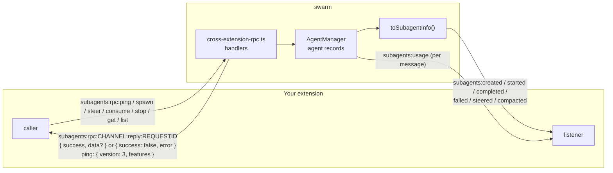
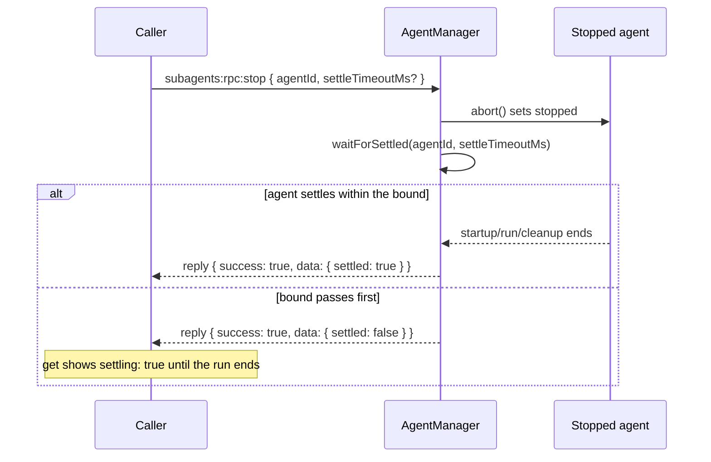
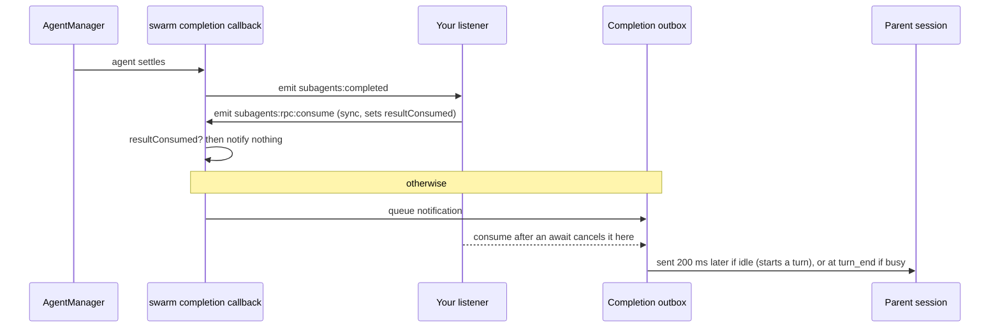
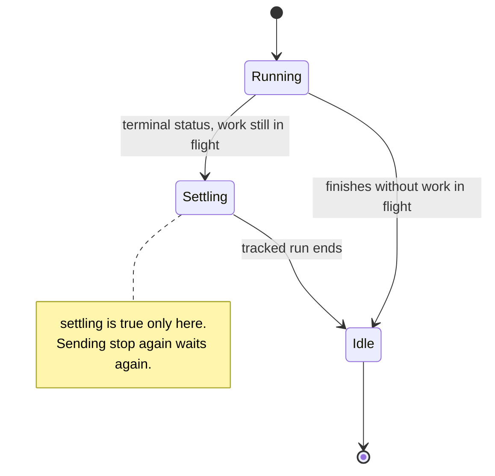
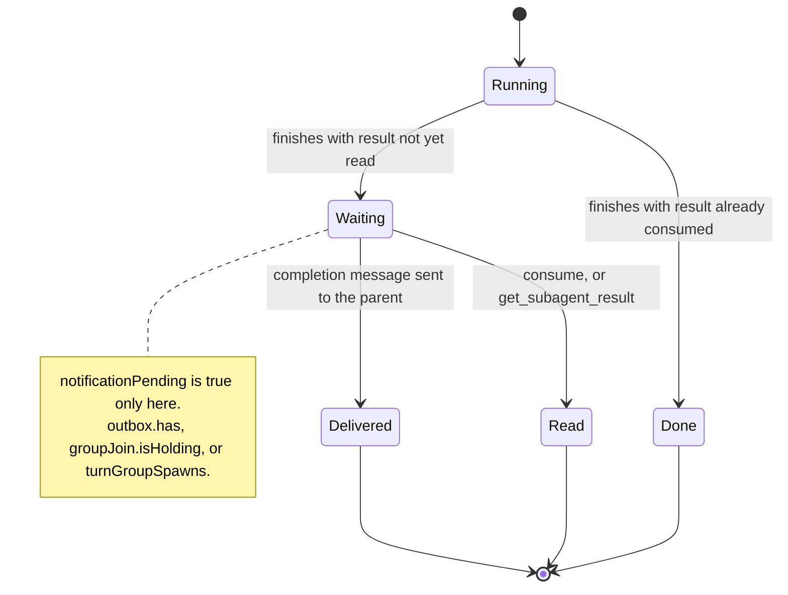

# Driving subagents from another extension

Another pi extension can spawn a subagent, listen for subagent completion, read the result, steer and stop the run — all over the `pi.events` bus, without importing this package directly. Seven request/reply channels (`subagents:rpc:ping`, `subagents:rpc:spawn`, `subagents:rpc:stop`, `subagents:rpc:consume`, `subagents:rpc:steer`, `subagents:rpc:get`, `subagents:rpc:list`), the lifecycle events in README's [event table](../README.md#events), one per-message usage event (`subagents:usage`), one terminal `subagents:disposed`, and one in-process registry at `Symbol.for("pi-subagents:manager")`.

The bus is **in-process**. `pi.events.emit` dispatches listeners synchronously, but an RPC handler can await work before emitting its reply on the same bus. That single fact explains most of what follows: why `signal` and the `on*` callbacks work on a spawn payload at all, why a `consume` fired inside a `subagents:completed` handler lands *before* the notification decision has been made, and why none of this survives a real process boundary.

For the channel list, the reply envelope, the per-channel snippets and the event table, see [`README.md`](../README.md#cross-extension-rpc). This document is the reference README does not have room for: the complete spawn-option surface, every error string, the notification race, the registry, and what protocol version `3` does and does not promise.

Install swarm with `pi install git:github.com/lfld287/swarm`.

## The surface at a glance

Everything goes through `pi.events`. The lifecycle events push one agent shape, `SubagentInfo` (`toSubagentInfo` in `src/subagent-info.ts`). `get` and `list` return the same shape on request. `spawn`, `steer`, `consume` and `stop` act on an agent. Every request gets its answer on its own `:reply:<requestId>` channel.



## Spawn acceptance

`subagents:rpc:spawn` takes `{ requestId, type, prompt, options? }`. In v3 a successful reply is `{ success: true, data: { id, status } }`: the manager has **accepted** the request and reserved an ID. `status` is a snapshot at acceptance, normally `queued` or `running`. `running` means a slot was reserved, not that the session or worktree is ready. A spawn returns its ID without waiting for startup. An already-aborted `signal` can give a receipt with `status: "stopped"`. A startup failure (including worktree creation or session initialization) produces a terminal `error` record for that ID and `subagents:failed`, not a later RPC error. Use `get` to read the terminal record, or subscribe to `subagents:completed` and `subagents:failed` before sending the request.

Spawns always run in the background and use the shared `maxConcurrent` limit. The old `isBackground` option is ignored; it cannot select or bypass a pool. `type` names an enabled custom agent definition. Previously bundled names are not guaranteed to exist. Define or install the role and name it explicitly; unknown, disabled or ambiguous types are refused unless `fallbackSubagent` explicitly names an enabled custom role.

## Spawn options

`subagents:rpc:spawn` forwards `options` to `AgentManager.spawn` — but not verbatim. The manager's `spawn` behind the RPC is `spawnTopLevel` in `src/index.ts`, which deletes internal-only fields first, and then `spawnResolved` overwrites the activity-tracker callbacks with its own. The full interface is `SpawnOptions` in `src/agent-manager.ts`; what a bus caller actually gets is three different things.

**Honoured** — set these and they take effect:

| Field | Type | Notes |
|---|---|---|
| `description` | string | What the agent is doing. Shown in the widget, FleetView and the completion notification |
| `name` | string | A memorable second handle (`auth-audit`). Slugged, never validated — anything unusable degrades rather than failing the spawn |
| `model` | `Model` **or** `"provider/modelId"` | Strings are resolved at the RPC boundary against `ctx.modelRegistry`. `null` means inherit, not override. Resolution is fuzzy — see [Model Scope](../README.md#model-scope) |
| `maxTurns` | number | Turn ceiling for the run |
| `isolated` | boolean | Strips extensions and skills. Applies only when the agent file leaves `isolated:` unset — frontmatter is authoritative. **Not** a git worktree — see the trap table below |
| `inheritContext` | boolean | Fork the parent conversation into the child. Only this option decides — an agent file's `inherit_context:` does not apply to RPC spawns |
| `thinkingLevel` | ThinkingLevel | Clamped to what the resolved model supports |
| `structuredOutput` | `CompiledSchema` | Adds the `StructuredOutput` tool for a validated report. Pass the `compiled` value from a successful `compileJsonSchema` (`src/json-schema.ts`), not the raw schema. Read JSON text from `structuredJson` on the record or terminal event |
| `disallowedTools` | string[] | Deny extra tools for this run, in addition to the role’s denylist |
| `isolation` | `"worktree"` or `"off"` | Temp git worktree, committed to a `pi-agent-*` branch on completion. The agent file's `isolation:` wins: `worktree` applies even when this is omitted, and `off` refuses it |
| `cwd` | absolute path | The agent's tools operate here; `.pi` config still loads from the parent session's project, and the child reports this directory as untrusted (`ctx.isProjectTrusted()` is `false`) |
| `invocation` | AgentInvocation | Resolved snapshot used for UI display |
| `signal` | AbortSignal | Aborting it stops the subagent |
| `onSpawned` | `(id) => void` | Called just before invoking the runner, including after queue drain; not a session-ready signal |
| `onQueued` | `(id, ahead) => void` | Called when queued, with the number of queue entries ahead of this one |
| `onCompaction` | function | Called after the agent session compacts |
| `onAssistantUsage` | function | Called with each assistant message's usage |
| `onBeforeWorktreeCleanup` | `(worktreePath) => Promise<void>` | On normal settlement with a worktree, awaited before preserving changes and removing it; a rejected callback does not prevent cleanup |

**Silently stripped** — set these and nothing happens, with no error and no note. Each deletion is a deliberate guard, and the reasons are worth knowing because they say what the surface refuses to let a caller forge:

| Field | Why it is taken away |
|---|---|
| `configCwd` | The config-discovery root is internal; `cwd` changes where tools run without changing the config root |
| `rootSessionId` | Names a transcript directory, so a forged value is a path-traversal primitive |
| `resumeSessionFile` | Worse: it names a file to **open and replay** as a conversation. Dispatcher only, and only from a path this extension itself recorded |
| `reclaim` | Bypasses handle allocation; a forged value could collide with a live agent's handle or alias and make lookup ambiguous |
| `bypassQueue` | Skipping the queue check is reserved for the scheduler |

**Silently overwritten** — `onToolActivity`, `onTextDelta`, `onTurnEnd` and `onSessionCreated` are replaced by the activity tracker's own (`spawnResolved`, `src/index.ts`). Every programmatic spawn passes through one funnel so none can supply half-wired callbacks; a half-wired tracker renders worse than none, which is the bug behind a row that reads `thinking…` for an agent's whole life ([#181](https://github.com/tintinweb/pi-subagents/pull/181)).

If `options.description` is omitted or `null`, `spawnTopLevel` derives it from the prompt. Omitting the entire `options` object is valid. The bus is in-process, so `signal` can be an actual `AbortSignal` and `on*` values can be functions; those cannot be sent as JSON.

### Names that look right and are not

Use the manager's camelCase option names, not the `Agent` tool or frontmatter spellings.

| You might write | What it does | What you meant |
|---|---|---|
| `isBackground` / `run_in_background` | Ignored; every RPC spawn is background and pooled | Omit both |
| `isolated: true` | Disables extensions and skills | `isolation: "worktree"` for a git worktree |
| `isolation: "worktree"` | Creates a git worktree | `isolated: true` to strip capabilities |
| `configCwd` | Stripped | `cwd` |
| `max_turns` / `thinking` / `inherit_context` | Ignored — tool and frontmatter spellings | `maxTurns` / `thinkingLevel` / `inheritContext` |
| `memory` | Nothing. **There is no such option** | Memory scope comes only from the agent definition's frontmatter |

**None of these produce an error.** Option keys are not validated on this path at all — unknown ones are accepted and dropped.

## Errors

A request rejected by an RPC handler reaches the caller as `{ success: false, error }`, where `error` is `err?.message ?? String(err)` (`handleRpc` in `src/cross-extension-rpc.ts`) — so these strings are what you will actually see.

| Error | Source |
|---|---|
| `No active session` | spawn handler, `src/cross-extension-rpc.ts` — if a handler is present but has no active session. With no handler there is no reply |
| `Model override "<label>" provided but ctx.modelRegistry is unavailable` | spawn handler, `src/cross-extension-rpc.ts` |
| `Model not found: "<input>".` + available models | `resolveModel`, `src/model-resolver.ts` |
| `Model not in scope: "<input>".` + allowed models | `checkModelScope`, `src/model-scope.ts` — only with `scopeModels` on, and checked against the *resolved* model |
| `Unknown, disabled, or ambiguous agent type: "<raw>". Available: <list>.` | `resolveSpawnTypeIn`, `src/agent-types.ts` — if no fallback is configured |
| `No agent type given. Available: <list>.` | `resolveSpawnTypeIn` — same condition |
| `<reason> The configured fallbackSubagent "<x>" is unknown, disabled, or ambiguous. Available: <list>.` | `resolveSpawnTypeIn` |
| `SpawnOptions.cwd must be an absolute path: "<value>"` | `assertValidSpawnCwd`, `src/agent-manager.ts` |
| `SpawnOptions.cwd does not exist: "<cwd>"` | `assertValidSpawnCwd` |
| `SpawnOptions.cwd is not a directory: "<cwd>"` | `assertValidSpawnCwd` |
| `The subagent manager has shut down` | `AgentManager.spawn` |
| `Agent prompt must be a string` / `Agent description must be a string` | `AgentManager.spawn`, request validation |
| `SpawnOptions.signal must be an AbortSignal` | `AgentManager.spawn`, request validation |
| `Agent not found` | stop, steer, or get handler, `src/cross-extension-rpc.ts` |
| `settleTimeoutMs must be a number of milliseconds` | stop handler — `settleTimeoutMs` is set but is not a finite number. Checked before the abort, so nothing is stopped |
| `Agent is not running` | stop handler. The agent exists, has finished, and no work is still settling |
| `Agent not found or still running` | consume handler |
| `Steer message must be a non-empty string` | steer handler — `message` missing, not a string, or whitespace |
| `Agent is not running` | steer handler — the record is no longer running or queued |

Type errors above also include guidance on defining or enabling a custom role. Startup errors are different: for example, if `isolation: "worktree"` cannot be created, the accepted record ends in `error` with a diagnostic, and the manager does not start the agent unisolated. A `cwd` valid at acceptance can likewise disappear before a queued spawn starts.

Three things the table cannot show:

- **The failure that is not an error.** With `worktreeIsolation` off project-wide, `isolation: "worktree"` is dropped by the `isWorktreeIsolationEnabled()` check in `AgentManager.startAgent` with no error, no note on the record, and a success envelope on the wire. Your agent runs in the main tree. If you asked for isolation because two agents were going to write the same files, they now collide and nothing told you.
- **`data` is omitted** when a handler returns nothing, so a successful consume or steer reply is a bare `{ success: true }` and `reply.data.anything` throws. A successful stop replies `{ success: true, data: { settled } }`; see [Stopping](#stopping).
- **`requestId` is not validated.** It is interpolated straight into the reply channel, so a caller that omits it gets its reply on the literal channel `subagents:rpc:spawn:reply:undefined` — where every other caller that omitted it is also listening. Send one, and send a unique one.

## Stopping

`subagents:rpc:stop` aborts the agent, then waits to reply until the agent’s startup, execution and cleanup have finished (`waitForSettled` in `src/agent-manager.ts`, #443). `abort()` sets the status to `stopped` immediately, but a tool call that ignores the abort, such as a file write or a shell command, keeps running until it returns. Without the wait, that write could land on top of replacement work the caller started after the reply.

- **Time limit.** `settleTimeoutMs` on the request caps the wait. It is optional, clamped to `0`..`60000`, and defaults to `STOP_SETTLE_TIMEOUT_MS` (5 s, `src/cross-extension-rpc.ts`). The default stays under the 10 s pi-tasks allows for the stop reply. `0` replies immediately with the current state.
- **`settled: false`** means the time ran out and something may still be running.
- **Sending stop again.** After `settled: false`, `get` shows the agent with `settling: true` (see [Reading agent state](#reading-agent-state)). A second stop finds nothing to abort but something still running, so it goes straight to the wait and replies `{ settled }`. `Agent is not running` means everything has finished.
- **How it tracks runs.** `AgentManager` keeps a set of runs that have not finished (`trackRun`). `isSettling` and `waitForSettled` both read it.
- **Terminal event.** `subagents:failed` for the stopped agent is emitted as it settles; receiving it is not the same as receiving a `settled: true` reply.
- **`reply.success`** only confirms the stop request was handled; `data.settled` says whether the run actually settled.



Stop, steer and get take a manager record ID. Consume also accepts a handle (the name without `@`). There is no ownership filter between extensions sharing the same session manager.

## Lifecycle events and reports

**`subagents:disposed` is the last event of a session.** It is emitted at the end of this extension's `session_shutdown`, after every agent is stopped and every child session has shut down, so no `subagents:usage` can follow it. A listener gets only its synchronous prefix on quit: `pi.events.emit` does not await listeners, and pi calls `process.exit` once the shutdown handlers return. Flush with `writeFileSync`, not `fs.promises`. Fields, and the other events, are in README's [event table](../README.md#events).

**Read a finished agent's report from the final event.** `subagents:completed` and `subagents:failed` carry the shared [agent fields](../README.md#agent-fields). A caller that spawned with `options.structuredOutput` reads the validated report from `structuredJson` and the session file path from `sessionFile`, without the registry. Both are left out when there is no value: `structuredJson` when no schema was passed or no valid report was produced, `sessionFile` when the session was not saved to disk. `structuredJson` is JSON text; `JSON.parse` it.

## The notification race

When a background agent finishes, swarm sends the user a completion notification. If you have already shown the model that result yourself, that notification arrives on top of an answer that was already given, and it costs the parent a turn to dismiss. `subagents:rpc:consume` is how you say you have handled it — the bus-side half of what `get_subagent_result` does when it returns a result.

**When you send it decides whether it works.** The timeline:

1. The agent settles, and the manager's completion callback in `src/index.ts` emits `subagents:completed`.
2. Next, in the same synchronous callback, it checks `record.resultConsumed` and decides whether to notify at all.
3. `pi.events` dispatch is synchronous and in-process, so a handler that emits `subagents:rpc:consume` **without awaiting anything** has already set that flag before step 2 evaluates.



| When you consume | What happens |
|---|---|
| Synchronously, inside your `subagents:completed` handler | The notification is never scheduled. This is the clean path |
| After an `await`, before the notification is sent | Still suppressed. The notification waits in the outbox (`src/completion-outbox.ts`), and consuming the result cancels it there. It is sent about 200 ms after the completion when the parent is idle (`NOTIFICATION_HOLD_MS`), and at the end of the parent's current tool batch when it is busy |
| After it was sent | Too late. pi has queued it with `triggerTurn: true`, and it costs the parent a model call |

Fire-and-forget is the intended use: the reply carries nothing to act on, and the channel sits outside the `subagents:rpc:ping` version handshake on purpose (the comment on the consume handler, `src/cross-extension-rpc.ts`), so you can send it unconditionally and an older build with no handler simply keeps notifying.

Consumption is not permanent across runs: a resume (`AgentManager.resume`) resets the consumed flag so the new result can be delivered.

One related thing that lives nowhere else: on every agent settle, swarm writes a session entry — not an event — via `pi.appendEntry("subagents:record", …)` (the manager's completion callback, `src/index.ts`; the shape is `AgentRecordEntryData` in `src/agent-record-entry.ts`), carrying `id`, `type`, `description`, `status`, `result`, `error`, `startedAt` and `completedAt`, plus `sessionFile`, `handle` and `alias` when the agent has them, and `worktreeLost: true` when its work lived in a worktree that has since been removed. `get_subagent_result` answers from it once the live record is gone, by id or by the entry's handle or alias. `Agent({ resume })` reopens the agent's session from its id, and the entry also serves cross-extension history reconstruction. It is append-only history, not something to react to.

## Steering a running agent

`subagents:rpc:steer` `{ requestId, agentId, message }` delivers `message` into a running or queued agent's conversation, the bus-side half of the `steer_subagent` tool. It exists for the caller that spawned an agent over the bus and then learns something that agent needs mid-run — a second CI failure on the head it is already fixing, a review that landed while it works — and would otherwise have to choose between spawning a duplicate agent for the same work and dropping the fact.

It takes an id only, and answers `Agent is not running` for a record that has settled. A message buffered before the agent's session exists is flushed once the session is initialized. Unlike RPC, the `steer_subagent` tool does not accept agents still in the concurrency queue. A successful steer emits `subagents:steered` with the agent fields plus `message`,. An older build has no handler and the request times out on your side: check `features.includes("steer")` on the `ping` reply first, or give it a timeout and treat expiry as "not available here".

## Reading agent state

`subagents:rpc:get` `{ requestId, agentId }` replies `{ agent }`. `subagents:rpc:list` `{ requestId }` replies `{ agents }`. Both return the [agent fields](../README.md#agent-fields) the lifecycle events carry, built by the same `toSubagentInfo` (`src/subagent-info.ts`). Use them when your extension loaded after the events it needed had already fired. Detect them with `features.includes("get")` / `"list"` on the `ping` reply.

`list` returns every agent the manager holds, in any status. Filter on `status` as needed.

A record stays readable until the manager removes it: 10 minutes after the agent finishes (`cleanup` in `src/agent-manager.ts`), or sooner, at a session start or switch, if its result was consumed (`clearCompleted(true)` keeps records whose result was not read). After that, `get` returns `Agent not found`, and only the agent's saved `subagents:record` session entry remains.

Both add two fields the events do not have. Both are computed when you ask, not stored on the record.

**`settling: true`**: the agent’s status is terminal, but its own startup, execution or cleanup has not settled. For example, a stopped agent may still be in a tool call that ignored the abort. A `{ settled: false }` stop reply can be followed by this state. It clears when the tracked run settles; running and queued records do not use this flag.



**`notificationPending: true`**: a finished agent's completion message has not reached the parent yet (`isNotificationPending` in the `session_start` RPC wiring, `src/index.ts`). The message waits in one of three places:

- the completion outbox: 200 ms if the parent is idle, until `turn_end` if it is busy, and through an Esc
- a `group` waiting for the agent's siblings, up to 30 s
- a `group` spawn whose turn has not ended yet

When the message is sent, it starts a parent turn. So while it waits, `hasRunning()` is false and every `status` reads `completed`, yet a turn is still coming. That is the race in [#103](https://github.com/tintinweb/pi-subagents/issues/103). The field is never set once the result has been read (a read result gets no message).



The two fields are independent: a stopped background agent can have both set at once. An agent is idle when its `status` is final and neither field is set. The check to run before injecting your own prompt, with `agents` from a `list` reply:

```typescript
const active = agents.some((a) =>
  (a.status === "running" || a.status === "queued" || a.settling || a.notificationPending));
```

## The manager registry

`globalThis[Symbol.for("pi-subagents:manager")]` (`MANAGER_KEY` and `registryEntry`, `src/index.ts`) is a second integration surface — the standard Node cross-package singleton pattern, no bus involved:

| Member | Signature | Notes |
|---|---|---|
| `waitForAll()` | `() => Promise<void>` | Resolves when nothing is running. **All** agents, including ones you did not spawn — a shutdown barrier, not a join |
| `hasRunning()` | `() => boolean` | |
| `spawn(pi, ctx, type, prompt, options)` | `=> string` | **Is** `spawnTopLevel`, so the strip list above applies identically |
| `getRecord(id)` | `=> AgentRecord \| undefined` | Returns a live, mutable record. Prefer `subagents:rpc:get` for a public snapshot |

The first activation claims an empty slot. Shutdown releases it only if this activation claimed it (`ownsManagerRegistry` in `src/index.ts`).

Prefer the bus. The registry has no reply envelope, no version, and no availability event — `globalThis[Symbol.for("pi-subagents:manager")] === undefined` is the only probe you get, and it is process-wide, not a session availability check. `subagents:rpc:list` answers *what is still running*, including a finished agent whose notification is still on its way (`notificationPending`) or whose work is still settling (`settling`), and `subagents:rpc:get` hands a record back after its terminal event has passed, both with the public agent fields rather than the live `AgentRecord`. Reach for the registry only for a headless host that wants to block on `waitForAll()` before exiting.

## Protocol versions

`subagents:rpc:ping` replies `{ version: 3, features }` (`PROTOCOL_VERSION` and `FEATURES` in `src/cross-extension-rpc.ts`). V3 keeps the v2 envelopes but changes the spawn contract to background-only acceptance. Check `version` before interpreting `spawn` success, and check `features.includes(...)` for the capabilities you use. Do not assume a capability advertised by v2 is still present in v3.

| Feature | Means |
|---|---|
| `consume` | `subagents:rpc:consume` exists |
| `steer` | `subagents:rpc:steer` exists |
| `get`, `list` | `subagents:rpc:get` and `subagents:rpc:list` exist |
| `stop-settles` | The stop reply waits for the work to stop, returns `{ settled }`, and accepts `settleTimeoutMs` |
| `settling` | `get` / `list` set `settling`, and sending stop again while something still runs waits again |
| `notification-pending` | `get` / `list` set `notificationPending` |

You can send `consume` without checking: an older build has no handler and just keeps sending the completion message. For everything else, check the feature, and trust any error reply over your own guess.

## Availability

`subagents:ready` is the discovery signal. RPC handlers and the broadcast are wired on bound `session_start`, not during extension loading. Agent sessions do not bind this extension.

The consequence is worth stating plainly: **a session that excludes swarm is indistinguishable from swarm not being installed.** It emits no `subagents:ready` and answers nothing. Give discovery a timeout and treat expiry as "not available here" rather than waiting indefinitely. The payload is `{}` — read nothing off it. Handlers are torn down and `rpcHandle` reset in the `session_shutdown` handler, so a later `session_start` re-registers and re-emits.

RPC launches do not emit `subagents:created`. Use the accepted ID for bookkeeping. `subagents:started` fires when the manager reaches the runner, before child session initialization; a startup error may produce `subagents:failed` without a `started` event.

## What the tests pin

This document has no test of its own, so it is worth knowing which claims are actually held in place:

| Test | Level | Pins |
|---|---|---|
| `test/cross-extension-rpc.test.ts` | Mocked manager | Reply envelopes, protocol version and features, state reads, model scope, and the bounded stop contract |
| `test/agent-startup-error.test.ts` | Startup error paths | Failures are available on terminal records after acceptance |
| `test/rpc-lifecycle-gating.test.ts` | Real extension factory | Nothing wired at factory time, everything once at `session_start`, and live widget activity for RPC spawns ([#142](https://github.com/tintinweb/pi-subagents/issues/142)/[#181](https://github.com/tintinweb/pi-subagents/pull/181)) |
| `test/rpc-result-consumption.test.ts` | Real delivery path | The notification firing, and not firing, around `consume` |

## Reference implementation

[**`tintinweb/pi-tasks`**](https://github.com/tintinweb/pi-tasks) is the working integration and the one this surface was shaped by. Its `TaskExecute` drives `subagents:rpc:spawn` — including the serialized `"provider/modelId"` string form that the boundary now resolves — and its `TaskOutput` drives `subagents:rpc:consume`, which exists because pi-tasks joins an agent on `subagents:completed` and reports the result itself ([pi-tasks#62](https://github.com/tintinweb/pi-tasks/issues/62)).

Read it for the shape of the whole loop: waiting on `subagents:ready`, keeping an id-keyed map of outstanding spawns, resolving each from the `subagents:completed` / `subagents:failed` handler, and consuming the result in the same synchronous handler that reports it.
